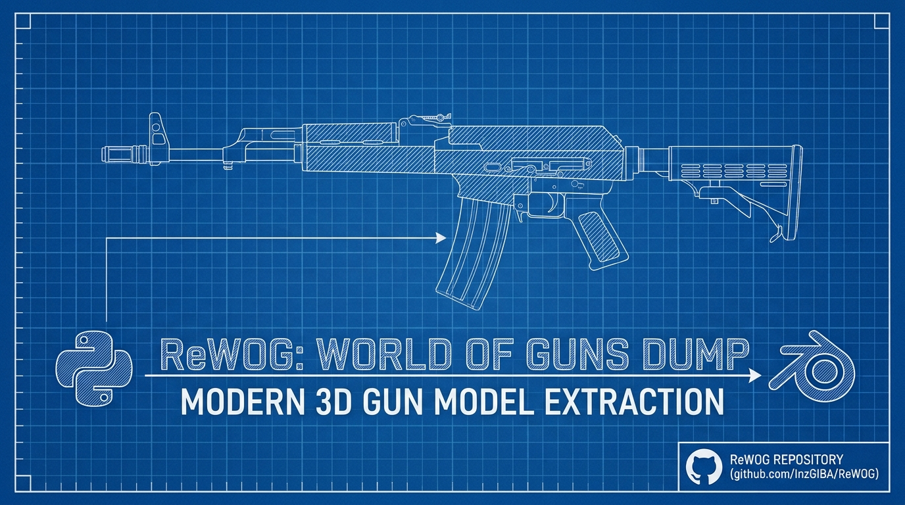

# ReWOG

<div align="center">



[](https://python.org)
[](LICENSE)
[](https://github.com/psf/black)
[](tests/)
[](tests/)
[](https://github.com/astral-sh/uv)
[](https://github.com/InzGIBA/ReWOG/issues)
[](https://github.com/InzGIBA/ReWOG/graphs/commit-activity)
[](https://github.com/InzGIBA/ReWOG/network)
[](https://github.com/InzGIBA/ReWOG/stargazers)

</div>

## Table of Contents

- [Description](#description)
- [What's New in v2.7](#whats-new-in-v27)
- [What's New in v2.6](#whats-new-in-v26)
- [Requirements](#requirements)
- [Installation](#installation)
- [How WOG Dump Works](#how-wog-dump-works)
- [Usage](#usage)
- [Project Structure](#project-structure)
- [Configuration](#configuration)
- [Testing](#testing)
- [Development](#development)
- [Contributing](#contributing)
- [Support](#support)
- [License](#license)
- [Special Thanks](#special-thanks)
- [FAQ](#frequently-asked-questions-faq)
- [Legal Disclaimer](#legal-disclaimer)

## Description

WOG Dump is a Python tool for extracting 3D gun models from [World of Guns: Gun Disassembly](https://store.steampowered.com/app/262410/World_of_Guns_Gun_Disassembly/). Version 2.7 fixes email/password login to match the current standalone client and adds account registration. Version 2.6 hardened downloads, storage and environment handling after a full security audit. Version 2.5 added one-command Blender scene export, and version 2.4 moved the tool to the `query2026` protocol with per-user credential storage and game-account login.

> **Educational Tool**: designed for 3D model enthusiasts, modders and researchers who study game assets and 3D modeling techniques.

### Who this tool is for

- 3D artists who want to study how a weapon is assembled from parts
- Modders and researchers interested in Unity asset formats and pipelines
- Educators looking for reference material on real-world weapon mechanics
- Anyone curious about game asset extraction techniques, for personal study

The project is actively maintained by [InzGIBA](https://github.com/inzgiba). If you run into trouble, see [Support](#support).

### What's New in v2.7

- **Email/password login fixed**: the login query now mirrors the standalone client exactly (password as MD5 digest under `pass=`, `session=0&id=0`, `lang`/`sys_info`/`platform` fields, no `?soc=steam` marker) and reads the account from the `acc_id` response field. Verified live in November 2026
- **`wog-dump register`**: creates a new game account (the standalone client's registration flow) and logs into it right away

### What's New in v2.6

- **Security hardening** (v2.6.0): asset and weapon names must match a strict alphabet, `.env` files apply only `WOG_*` keys, download resume needs a server validator, and log files are no longer world-readable. Some changes break old workflows on purpose, so read the 2.6.0 changelog entry before upgrading
- **CLI fixes** (v2.6.1): weapon-list import handles the new atlas format, material dumps work again, and `decrypt-assets --weapons` respects the filter again
- **`wog-dump build-scene`** (v2.5): rebuilds the in-game assembled weapon as a Blender-ready glTF scene: exact part hierarchy and positions, game materials with textures, camera and studio lighting, real-world scale
- **No extra objects**: UI arrows, cutaway meshes, muzzle-flash effects and animation dummies are classified and skipped (`--extras` exports them on request)
- **One-click Blender setup**: a generated `blender_setup.py` imports the scene, sorts collections and saves a `.blend`
- **query2026 protocol** (v2.4): targets the current game API (game `2.2.3t6`, Unity 6) with automatic re-login on session rejection
- **No secrets in the repo** (v2.4): bundled keys and captured credentials are gone. All data lives in a per-user SQLite database
- **`wog-dump login` / `logout`** (v2.4): use your own game account (email + password) to fetch keys
- **Live tests**: `pytest -m live` verifies fetch/download/decrypt against the real servers

## Requirements

- **Python 3.12+** (Required)
- [AssetStudio](https://github.com/Perfare/AssetStudio): for final asset unpacking

## Installation

### Quick Install with uv (Recommended)

[uv](https://github.com/astral-sh/uv) is a fast Python package installer and resolver.

```bash
# Install uv if you haven't already
curl -LsSf https://astral.sh/uv/install.sh | sh
# or with pip: pip install uv

# Clone the repository
git clone https://github.com/InzGIBA/ReWOG
cd ReWOG

# Install in development mode with uv
uv pip install -e .
```

### Alternative Installation Methods

**Traditional pip:**
```bash
# Clone repository
git clone https://github.com/InzGIBA/ReWOG
cd ReWOG

# Install with pip
pip install -e .
```

**Development Setup with uv:**
```bash
# Install with development dependencies
uv pip install -e ".[dev]"

# Run tests
pytest
```

## How WOG Dump Works

1. **Download Weapon List**: Fetches and processes the weapon catalog
2. **Fetch Decryption Keys**: Retrieves keys for each weapon asset
3. **Download Assets**: Downloads encrypted Unity3D files
4. **Decrypt Assets**: Uses XOR decryption to unlock files
5. **Unpack Assets**: Extracts models, textures, and materials
6. **Build Scene**: Rebuilds the assembled weapon as a Blender-ready glTF scene
7. **Convert Normal Maps**: Converts Unity normal maps to standard format

> **Authentication**: the key API only serves authenticated clients.
> Capture your own client once with a MITM proxy and run
> `uv run python scripts/extract_keys.py wog-keys.flows --identity --merge`.
> Keys and the client identity land in the local database, and the identity
> values go into your `.env` (see `.env.example`). Alternatively, log in with a
> game-account email/password (`wog-dump login`). Credentials, sessions, keys
> and the weapon list live in a local SQLite database outside the repository,
> so no sensitive data ships with the code. Details:
> [Capturing Keys and Identity via MITM](docs/mitm-capture.md).

## Usage

### Quick Start Guide

**Complete Extraction (Recommended):**
```bash
# Extract all weapons with normal map conversion
wog-dump full-pipeline --update-keys --convert-normals
```

**Step-by-Step Process:**
```bash
# 1. Check configuration and status
wog-dump info

# 2. Log in with your game account (once, creates a local database)
wog-dump login

# 3. Download weapon catalog
wog-dump download-weapons

# 4. Download and decrypt assets
wog-dump download-assets --update-keys
wog-dump decrypt-assets

# 5. Extract models and textures
wog-dump unpack-assets

# 6. Build a Blender-ready scene (assembled exactly like in game)
wog-dump build-scene ak47

# 7. Convert normal maps (optional)
wog-dump convert-normals ./unpacked --recursive
```

### Command Line Interface

WOG Dump ships a full CLI with multiple commands:

```bash
# Get help for any command
wog-dump --help
wog-dump <command> --help

# View configuration and system status
wog-dump info

# Complete pipeline with all options
wog-dump full-pipeline --verbose --max-threads 8 --update-keys --convert-normals
```

> **Tip**: run `wog-dump info` to check your configuration and free disk space before starting large operations.

### Individual Commands

**Download Management:**
```bash
# Download weapon list from servers
wog-dump download-weapons

# Download assets with key updates
wog-dump download-assets --update-keys

# Check for updates without downloading
wog-dump download-assets --check-only

# Download specific weapons only
wog-dump download-assets --weapons "ak74,m4a1,glock17"
```

**Processing Operations:**
```bash
# Decrypt all downloaded assets
wog-dump decrypt-assets

# Decrypt specific weapons
wog-dump decrypt-assets --weapons "ak74,m4a1"

# Unpack Unity assets to models/textures
wog-dump unpack-assets

# Build a Blender-ready scene from decrypted bundles
wog-dump build-scene ak47               # assembled weapon, game materials
wog-dump build-scene ak47 colt_1911     # several weapons at once
wog-dump build-scene ak47 --extras all  # include UI arrows/cutaway/VFX

# Convert normal maps with backup
wog-dump convert-normals ./textures --recursive --backup
```

**Blender scene output** (`runtime/scenes/<weapon>/`):
```
<weapon>.glb        # full scene: hierarchy, materials, camera, studio lights
blender_setup.py    # one-click Blender import + collections + .blend save
scene.json          # manifest: counts, skipped objects, parts/field-strip lists
textures/           # source PNG textures (also embedded in the GLB)
```

Open the GLB in Blender directly (`File > Import > glTF 2.0`), or run the
generated script for a configured scene (collections, hidden extras, active
camera, saved `.blend`):

```bash
blender --background --python runtime/scenes/ak47/blender_setup.py
```

**Configuration and Monitoring:**
```bash
# Show detailed configuration
wog-dump info --verbose

# Enable debug logging for troubleshooting
wog-dump --debug full-pipeline

# Use custom thread count for parallel processing
wog-dump --max-threads 16 download-assets
```

### Advanced Workflows

**Selective Processing:**
```bash
# Process only specific weapon categories
wog-dump download-assets --weapons "ak74,ak47,akm"  # AK variants
wog-dump download-assets --weapons "m4a1,m16a4"     # M4/M16 variants

# Check what needs updating without downloading
wog-dump download-assets --check-only

# Refresh the weapon list from the server
wog-dump download-weapons --force
```

**Performance Optimization:**
```bash
# High-performance setup for strong machines
wog-dump --max-threads 16 full-pipeline

# Conservative setup for limited resources
wog-dump --max-threads 2 --verbose full-pipeline

# Memory-efficient processing for large batches
wog-dump full-pipeline --chunk-size 4096
```

**Cache Management:**
```bash
# Import weapons.txt / keys.txt into the local database
wog-dump cache --migrate

# Show detailed cache statistics
wog-dump cache --show-cache

# Check downloaded assets exist and are non-empty
wog-dump cache --validate-assets
```

**Development and Testing:**
```bash
# See what would be downloaded without downloading anything
wog-dump download-assets --check-only

# Validate decrypted files after decryption
wog-dump decrypt-assets --validate

# Show full configuration and file status
wog-dump info --verbose
```

### Using as Python Library

```python
from wog_dump.core.download import DownloadManager
from wog_dump.core.decrypt import KeyManager, AssetDecryptor
from wog_dump.core.config import get_config

# Get configuration
config = get_config()

# Download assets
with DownloadManager(config) as downloader:
    successful, failed = downloader.download_assets(["ak74", "m4a1"])

# Decrypt assets
key_manager = KeyManager(config)
keys = key_manager.load_keys()

decryptor = AssetDecryptor(config)
decrypted_files, failed_assets = decryptor.decrypt_all_assets(keys)
```

## Project Structure

```
ReWOG/
├── src/wog_dump/                    # Main package (source layout)
│   ├── __init__.py                  # Package initialization, single version source
│   ├── core/                        # Core business logic
│   │   ├── __init__.py
│   │   ├── config.py                # Pydantic configuration management
│   │   ├── http.py                  # Shared HTTP session factory + rate limiting
│   │   ├── api.py                   # BZ2-over-HTTP query API client
│   │   ├── auth.py                  # Game-account login and identity
│   │   ├── database.py              # Local SQLite storage (weapons/keys/auth)
│   │   ├── keys.py                  # Decryption key fetching and caching
│   │   ├── paths.py                 # Name validation and path containment (security)
│   │   ├── download.py              # Resumable parallel asset downloading
│   │   ├── decrypt.py               # XOR decryption (pure Python)
│   │   ├── unpack.py                # Unity asset extraction (per-type extractors)
│   │   ├── scene.py                 # Blender scene export (game hierarchy to glTF)
│   │   ├── glb.py                   # In-package glTF 2.0 / GLB writer
│   │   └── key_import.py            # MITM capture parsing (keys import)
│   ├── resources/
│   │   └── blender_setup.py         # Template for the generated Blender setup script
│   ├── utils/                       # Utility modules
│   │   ├── __init__.py
│   │   ├── logging.py               # Rich-formatted logging
│   │   └── normal_map.py            # Normal map format conversion
│   └── cli/                         # Command-line interface
│       ├── __init__.py
│       ├── main.py                  # Click group, global options, main()
│       ├── errors.py                # Shared CLI error handling
│       ├── download.py              # download-weapons / download-assets
│       ├── decrypt.py               # decrypt-assets
│       ├── unpack.py                # unpack-assets
│       ├── convert.py               # convert-normals
│       ├── scene.py                 # build-scene
│       ├── pipeline.py              # full-pipeline
│       ├── auth.py                  # login / logout / register
│       ├── cache.py                 # cache
│       └── info.py                  # info
├── tests/                           # Comprehensive test suite
│   ├── conftest.py                  # Pytest configuration and fixtures
│   ├── unit/                        # Unit tests for individual modules
│   └── integration/                 # CLI end-to-end and live-server tests
├── docs/                            # configuration.md, architecture.md, database.md, ...
├── scripts/                         # extract_keys.py (MITM key import)
├── CHANGELOG.md                     # Version history and migration guides
├── CONTRIBUTING.md                  # Development and contribution guidelines
├── README.md                        # This file (main documentation)
└── pyproject.toml                   # Modern Python packaging (PEP 621)
```

## Configuration

WOG Dump uses Pydantic for configuration management:

```python
# Configuration is automatically managed
# Default directories: assets/, encrypted/, decrypted/
# Customizable via CLI options or environment variables

# View current configuration
wog-dump info
```

In-depth reference:

- **[docs/configuration.md](docs/configuration.md)**: every environment variable, `.env` setup, rate limiting and resumable downloads
- **[docs/architecture.md](docs/architecture.md)**: how the modules fit together, the extraction pipeline
- **[docs/database.md](docs/database.md)**: where your keys and credentials live, schema and migration from pre-2.4 files
- **[docs/mitm-capture.md](docs/mitm-capture.md)**: capturing keys and identity from your own game traffic

## Testing

```bash
# Run all tests
pytest

# Run with coverage
pytest --cov=wog_dump

# Run specific test categories
pytest tests/unit/          # Unit tests only
pytest tests/integration/   # Integration tests only
pytest -m slow              # Slow tests
pytest -m live              # Live tests against the real servers (needs auth in .env)
```

## Development

```bash
# Install development dependencies with uv
uv pip install -e ".[dev]"

# Code formatting
black src/ tests/
isort src/ tests/

# Type checking
mypy src/

# Linting
flake8 src/ tests/
```

## Contributing

We welcome contributions of every size: bug fixes, features and documentation all make WOG Dump better for everyone.

### Quick Links

- [Contributing Guidelines](CONTRIBUTING.md): detailed contribution process
- [Issue Tracker](https://github.com/InzGIBA/ReWOG/issues): report bugs or request features
- [Discussions](https://github.com/InzGIBA/ReWOG/discussions): ask questions and get help
- [Support](SUPPORT.md): troubleshooting and ways to get help
- [Code of Conduct](CODE_OF_CONDUCT.md): community standards

### Quick Start for Contributors

1. **Fork and Clone**
   ```bash
   git clone https://github.com/your-username/ReWOG
   cd ReWOG
   ```

2. **Set up Development Environment**
   ```bash
   uv pip install -e ".[dev]"
   ```

3. **Create Feature Branch**
   ```bash
   git checkout -b feature/amazing-feature
   ```

4. **Make Changes and Test**
   ```bash
   # Make your changes
   pytest               # Run tests
   black src/ tests/    # Format code
   ```

5. **Submit Pull Request**
   ```bash
   git commit -m 'feat: add amazing feature'
   git push origin feature/amazing-feature
   # Then create PR on GitHub
   ```

### Types of Contributions Welcome

- **Bug Reports**: help us identify and fix issues
- **Feature Requests**: suggest new functionality
- **Documentation**: improve guides, examples, and help text
- **Testing**: add test coverage or improve existing tests
- **Performance**: optimize code for speed or memory usage
- **Localization**: add support for other languages
- **Packaging**: improve installation and distribution

### Recognition

All contributors are recognized in our [CHANGELOG.md](CHANGELOG.md) and commit history. Significant contributors get invited to join the core team.

## Support

Where to get help, in the order we recommend:

1. **FAQ and Troubleshooting** in this README (see [Frequently Asked Questions](#frequently-asked-questions-faq))
2. **[SUPPORT.md](SUPPORT.md)**: diagnostics, common solutions, and how to report issues effectively
3. **[GitHub Issues](https://github.com/InzGIBA/ReWOG/issues)**: bug reports and feature requests (public, searchable)
4. **[GitHub Discussions](https://github.com/InzGIBA/ReWOG/discussions)**: questions and general help

Please use the public channels above so answers remain useful to others. For security-sensitive reports only, email the maintainer directly: [inzgiba@gmail.com](mailto:inzgiba@gmail.com).

## License

This project is licensed under the MIT License. See the [LICENSE](LICENSE) file for details.

## Special Thanks

- [DeadZoneGarry](https://github.com/DeadZoneLuna): original decryption research
- [Noble Empire Corp.](https://noble-empire.com/news.php): game and assets
- Contributors to the original WOG Dump project

## Frequently Asked Questions (FAQ)

### General Questions

**Q: What is WOG Dump and what does the tool do?**
A: WOG Dump extracts 3D gun models, textures, and materials from the World of Guns: Gun Disassembly game for study, research, and personal use.

**Q: Do I need to own the game to use this tool?**
A: The tool downloads public asset files from the game's servers. Game ownership is not required for the tool to work, but we recommend owning the game to support the developers.

**Q: What file formats does WOG Dump extract?**
A: The tool extracts Unity3D assets including:
- Blender-ready scenes (glTF 2.0 via `build-scene`: game hierarchy, materials and textures)
- 3D Models (OBJ format)
- Textures (PNG, TGA formats)
- Materials and shaders
- Normal maps (converted to standard format)

### Technical Questions

**Q: Why is Python 3.12+ required?**
A: We use Python 3.12+ features: native type annotations (`list[str]` instead of `List[str]`) and improved error handling.

**Q: Does this work on Windows, macOS and Linux?**
A: Yes. The tool is pure Python and works on all major operating systems. The v2 release removed all C dependencies.

**Q: How much disk space do I need?**
A: Plan for:
- Encrypted assets: ~2-5 GB
- Decrypted assets: ~2-5 GB
- Extracted models/textures: ~3-8 GB
- Total recommended: **10-20 GB free space**

**Q: Is internet connection required?**
A: Yes, for downloading assets from game servers. After the initial download, everything else works offline.

### Usage Questions

**Q: How long does the complete extraction take?**
A: Depends on your system and internet speed:
- Fast system (SSD, 8+ cores, 50+ Mbps): ~1-3 minutes
- Average system (HDD, 4 cores, 25 Mbps): ~5-10 minutes
- Slow system (older hardware, slow internet): ~15-30 minutes

**Q: How do I extract only specific weapons?**
A: Yes. Use the `--weapons` parameter:
```bash
wog-dump download-assets --weapons "ak74,m4a1,glock17"
```

**Q: What if the download fails or gets interrupted?**
A: The tool resumes interrupted downloads. Run the same command again, and the download continues where the previous run stopped.

**Q: Key fetching logs `API error for X: Server error` / `No key available`. What is wrong?**
A: Two common causes. (1) No valid session: run `wog-dump register` to create a game account, `wog-dump login` for an existing one, or capture your client once ([MITM guide](docs/mitm-capture.md)) and put `WOG_AUTH_ID`/`WOG_AUTH_SESSION` into `.env`. (2) An outdated endpoint/protocol: this tool now targets `query2026.php` with the current client versions (`2.2.3t6` / `6000.0.84f1`), verified against the live servers in November 2026.

**Q: Where are my credentials and keys stored?**
A: In a per-user SQLite database (`~/.local/share/wog_dump/wog_dump.db` on Linux, `%APPDATA%\wog_dump\` on Windows), with owner-only permissions. Nothing sensitive is stored in the repository. Set `WOG_DB_PATH` to use a different location. `wog-dump logout` removes the stored credentials. A repo-local `.env` (gitignored, see `.env.example`) provides `WOG_AUTH_ID`/`WOG_AUTH_SESSION`/`WOG_ACCOUNT_*` as an alternative.

**Q: How do I test against the real game servers?**
A: Yes, configure auth in `.env` and run `pytest -m live`. The live tests fetch a real key, download an asset, decrypt the file and load the bundle in UnityPy. The tests skip automatically when no credentials are configured.

### Troubleshooting

**Q: `No game account configured` when fetching keys**
A: The key API needs authentication. Either log in once with your game account:
```bash
wog-dump login
```
or put `WOG_ACCOUNT_EMAIL`/`WOG_ACCOUNT_PASSWORD` (or a captured `WOG_AUTH_ID`/`WOG_AUTH_SESSION`, see [docs/mitm-capture.md](docs/mitm-capture.md)) into `.env`. Check what is configured with `wog-dump cache`.

**Q: `Authentication failed (result=100)`**
A: The API rejected the account credentials. Verify the email/password pair in the game client itself, then `wog-dump login` again. If you use a captured session, the session expired. Capture a fresh one or switch to account login.

**Q: Key fetching fails with `Session rejected` (result=1000)**
A: The stored session expired. WOG Dump re-logins automatically. If the error persists, the stored credentials are outdated. Run `wog-dump logout && wog-dump login`.

**Q: `429` / rate-limit errors from the API**
A: Requests are too frequent. Raise the throttles in `.env`:
```bash
WOG_API_REQUEST_DELAY=2.0    # key API (default 0.5s)
WOG_REQUEST_DELAY=0.5        # asset downloads (default 0.1s)
```

**Q: `No weapon list found. Run 'download-weapons' first.`**
A: The database has no weapon list yet:
```bash
wog-dump download-weapons
```
Coming from a pre-2.4 installation with `runtime/weapons.txt`? Import the file once with `wog-dump cache --migrate`.

**Q: `No decryption keys found. Use --update-keys to fetch them.`**
A: There are no keys in the database. Fetch the keys for the weapons you need (auth must be configured):
```bash
wog-dump decrypt-assets --update-keys
```

**Q: The tool seems stuck or slow, what's wrong?**
A: Try these steps:
1. Check your internet connection
2. Reduce thread count: `wog-dump --max-threads 2 download-assets`
3. Enable verbose logging: `--verbose` (or `--debug` for everything)
4. Downloads are throttled by design. See `WOG_REQUEST_DELAY` above if you want them faster

**Q: Key API stopped working after a game update (`result=1000` on every request)**
A: The client version strings are validated server-side. Update the strings in `.env` to match the current client (find the values in the game's installation or a fresh capture):
```bash
WOG_GAME_VERSION=2.2.3u9
WOG_UNITY_VERSION=6000.0.84f1
```

**Q: Interrupted download: do I have to start over?**
A: No. Partial downloads are kept as `runtime/assets/*.tmp` and resumed via HTTP `Range` requests on the next run. If a `.tmp` file refuses to go away, delete the file to force a fresh download.

**Q: How do I report bugs or request features?**
A: Please create an issue on GitHub with:
- Your operating system and Python version
- Complete error message and traceback
- Steps to reproduce the problem
- Output of `wog-dump info`

## Legal Disclaimer

This tool is intended for **educational and research purposes only**. Users are responsible for:

- **Respecting Copyright**: All extracted assets remain the intellectual property of Noble Empire Corp.
- **Terms of Service**: Ensure compliance with the game's Terms of Service
- **Personal Use**: Use extracted content only for personal, educational, or research purposes
- **No Redistribution**: Do not redistribute game assets or use them commercially

**The authors and contributors are not responsible for any misuse of this software or violation of terms of service.**

For questions about asset usage rights, please contact Noble Empire Corp. directly.
