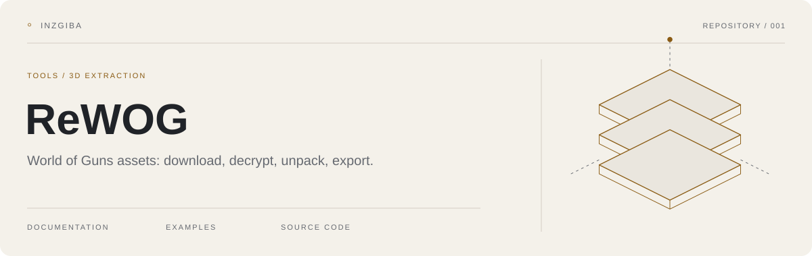
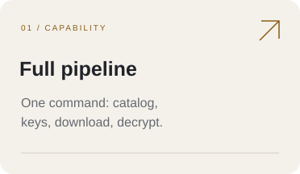
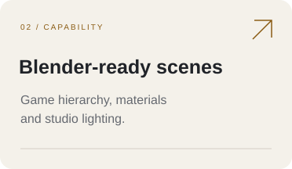
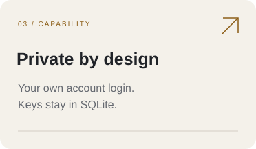

<picture>
  <source media="(prefers-color-scheme: dark)" srcset="assets/hero-dark.svg">
  <source media="(prefers-color-scheme: light)" srcset="assets/hero-light.svg">
  
</picture>

**WOG Dump: extract and rebuild 3D weapon models from [World of Guns: Gun Disassembly](https://store.steampowered.com/app/262410/World_of_Guns_Gun_Disassembly/).**

A command-line toolkit for 3D artists, modders and researchers who study game assets. WOG Dump logs in with your own game account, downloads encrypted Unity bundles from the game servers, decrypts them and rebuilds the weapon: one command turns the in-game AK-47 into a Blender-ready glTF scene with the exact part hierarchy, game materials and studio lighting. Scenes come out in disassembly states too, with an offline HTML viewer, STL/USD/FBX export, print preparation and turntable videos.

[Overview](#overview) · [Features](#features) · [Quick start](#quick-start) · [Usage](#usage) · [Configuration](#configuration) · [Development](#development) · [FAQ](#faq) · [Contributing](#contributing) · [License](#license)

<div align="center">

[](https://python.org)
[](LICENSE)
[](https://github.com/psf/black)
[](https://github.com/astral-sh/uv)
[](https://github.com/InzGIBA/ReWOG/issues)
[](https://github.com/InzGIBA/ReWOG/stargazers)

</div>

## Overview

WOG Dump automates the full path from the game's servers to usable 3D data: weapon catalog, per-asset decryption keys, encrypted downloads, XOR decryption, Unity unpacking and scene export. It targets the current `query2026` protocol (game `2.2.3t6`, Unity 6) and was verified live against the production API in November 2026.

- **For:** 3D artists, modders, educators and researchers studying weapon assembly and Unity asset pipelines
- **Input:** your game-account credentials (or a captured client session) and the weapons you want
- **Output:** decrypted Unity bundles, extracted models and textures (OBJ, PNG, TGA), glTF scenes in assembled or disassembled poses, an offline HTML viewer, STL/USD/USDZ/FBX export, print-ready parts and turntable videos
- **Scope:** personal, educational and research use, extracted assets remain the property of Noble Empire Corp. (see [License](#license))

> **What's new:** this release adds disassembly states and animated step-by-step builds, a self-contained HTML viewer with part annotations, STL/USD/USDZ/FBX export, print preparation, turntable and clip videos, the `catalog` command, a local web UI, CLI localization (Russian), a protocol compatibility probe, Docker images, a Blender addon and third-party extractor plugins. Full history: [CHANGELOG.md](CHANGELOG.md).

## Features

<picture>
  <source media="(prefers-color-scheme: dark)" srcset="assets/feature-01-dark.svg">
  
</picture>
<picture>
  <source media="(prefers-color-scheme: dark)" srcset="assets/feature-02-dark.svg">
  
</picture>
<picture>
  <source media="(prefers-color-scheme: dark)" srcset="assets/feature-03-dark.svg">
  
</picture>

- **Full pipeline**: one command goes from weapon catalog to keys, download, decryption and unpacking. Downloads run in parallel, respect rate limits and resume after interruptions.
- **Blender-ready scenes**: `build-scene` rebuilds the assembled weapon exactly like in game: part hierarchy and positions, game materials with textures, camera and studio lighting, real-world scale. UI arrows, cutaway meshes and VFX are classified and skipped unless you ask for them with `--extras`.
- **Disassembly states**: `--state field-strip` puts parts where the game itself puts them after removal, `--state exploded` pushes them apart along removal directions, `--state parts` lays everything out in a grid. `--assembly-steps` writes a step-by-step build, and `--animated` adds one glTF animation placing part after part.
- **Offline HTML viewer**: `--viewer` embeds the scene and the three.js runtime into one `viewer.html`: open it in any browser, click parts to highlight them, read annotations with part sizes. No Blender, no internet, no install.
- **Animations**: `--animations` embeds the bundle's operate animation (fire, reload, safety) as real glTF animation tracks.
- **Export formats**: `--format stl,usd,usdz,fbx` converts a built scene: binary STL for slicers (units baked in), USD/USDZ for AR with preview materials, FBX through headless Blender.
- **Print preparation**: `print-export` repairs and checks every part with trimesh, reports watertight status per part and writes millimeter-true STLs.
- **Previews and video**: `render` turns a built scene into transparent turntable PNGs plus a GIF, `--video` encodes an orbit MP4 or one animation clip, all through headless Blender.
- **Catalog**: `catalog` lists every weapon with its pipeline status and sizes, filters by name and stage, and emits a stable JSON schema other tools build on.
- **Web UI**: `serve` opens a local page with the same catalog, a 3D viewer per weapon and stage buttons with live logs.
- **Protocol probe**: `info --protocol-probe` answers "did I break something or did the game update" in one run: endpoint reachability, anonymous query, authenticated key query, weapon list, client version. Any failure exits with code 2.
- **Plugins**: third-party packages register extra Unity-type extractors through entry points, no fork needed (see [docs/plugins.md](docs/plugins.md)).
- **Localization**: `--locale ru` switches CLI messages to Russian, unknown locales fall back to English silently.
- **Private by design**: log in with your own game account (`login` / `register`) or a captured session. Credentials, sessions, keys and the weapon list live in a per-user SQLite database with owner-only permissions, no secrets ship with the repository.

## Quick start

### Requirements

- Python 3.12+
- [uv](https://github.com/astral-sh/uv) (recommended) or pip
- A game account: create one with `wog-dump register` or use your existing email/password
- Internet connection and ~10–20 GB of free disk space for a full extraction
- Optional: [AssetStudio](https://github.com/Perfare/AssetStudio) for browsing raw Unity bundles manually
- Optional: Blender, for preview renders, videos and FBX export

### Install

From [PyPI](https://pypi.org/project/rewog/):

```bash
pip install rewog

# USD/USDZ export support:
pip install "rewog[usd]"
# local web UI:
pip install "rewog[web]"
# print preparation:
pip install "rewog[print]"
```

From source (for development):

```bash
git clone https://github.com/InzGIBA/ReWOG
cd ReWOG

# with uv (install it via https://astral.sh/uv or `pip install uv`)
uv pip install -e .

# or with plain pip
pip install -e .
```

### Run your first extraction

```bash
# 1. Create a game account and log in (once; or `wog-dump login` for an existing one)
wog-dump register

# 2. Everything: weapon list, keys, download, decrypt, unpack, normal maps
wog-dump full-pipeline --update-keys --convert-normals

# 3. Rebuild one weapon as a Blender-ready scene
wog-dump build-scene ak47
```

Data lands under `runtime/`:

```text
runtime/
├── encrypted/       # raw encrypted Unity3D bundles
├── decrypted/       # decrypted bundles
├── unpacked/        # extracted models (OBJ) and textures (PNG, TGA)
└── scenes/ak47/     # ak47.glb + blender_setup.py + scene.json + textures/
```

Open `runtime/scenes/ak47/ak47.glb` in Blender (`File > Import > glTF 2.0`), or run the generated setup script for a configured scene with collections, hidden extras and a saved `.blend`:

```bash
blender --background --python runtime/scenes/ak47/blender_setup.py
```

### Then try this

```bash
# Disassembly poses, straight from the game's own removal data
wog-dump build-scene ak47 --state field-strip
wog-dump build-scene ak47 --state exploded --explode-distance 0.5

# A step-by-step build plus one animated assembly GLB
wog-dump build-scene ak47 --assembly-steps 5 --animated

# Show it to someone without Blender
wog-dump build-scene ak47 --viewer --annotate

# Print a part
wog-dump print-export ak47 --part bolt

# Turntable previews and an orbit video
wog-dump render ak47
wog-dump render ak47 --video --duration 8

# What do I have, and how do I share this page?
wog-dump catalog
wog-dump serve
```

## Usage

### Step by step

Each pipeline stage is also available as its own command:

```bash
wog-dump info                          # configuration and status; add --protocol-probe
wog-dump download-weapons              # fetch the weapon catalog
wog-dump download-assets --update-keys # download bundles + fresh keys
wog-dump decrypt-assets                # XOR-decrypt the bundles
wog-dump unpack-assets                 # extract models and textures
wog-dump build-scene ak47              # Blender-ready glTF scene
wog-dump render ak47                   # turntable previews; --video for MP4
wog-dump print-export ak47             # print-ready STLs with diagnostics
wog-dump catalog                       # per-weapon status table
wog-dump convert-normals ./unpacked --recursive   # optional: fix normal maps
```

Every command documents itself: `wog-dump --help` and `wog-dump <command> --help`.

### Common options

| Option | Purpose | Example |
| --- | --- | --- |
| `--weapons` | Limit a command to specific weapons | `--weapons "ak74,m4a1,glock17"` |
| `--update-keys` | Fetch fresh decryption keys first | `wog-dump download-assets --update-keys` |
| `--check-only` | Preview pending downloads without fetching | `wog-dump download-assets --check-only` |
| `--validate` | Verify decrypted files after decryption | `wog-dump decrypt-assets --validate` |
| `--extras` | Include UI arrows, cutaway meshes and VFX in a scene | `wog-dump build-scene ak47 --extras all` |
| `--state` | Disassembly pose: `field-strip`, `exploded`, `parts` | `wog-dump build-scene ak47 --state exploded` |
| `--assembly-steps` / `--animated` | Step-by-step build, add a placing animation | `wog-dump build-scene ak47 --assembly-steps 5 --animated` |
| `--animations` | Embed the operate animation in the GLB | `wog-dump build-scene ak47 --animations` |
| `--viewer` / `--annotate` | Self-contained HTML viewer, add part markers | `wog-dump build-scene ak47 --viewer --annotate` |
| `--format` | Extra formats: `stl`, `usd`, `usdz`, `fbx` | `wog-dump build-scene ak47 --format stl,usdz --stl-units mm` |
| `--video` / `--clip` | Orbit MP4 or one animation clip | `wog-dump render ak47 --video --clip "Take 001"` |
| `--part` / `--merge` | Print single parts or one combined layout | `wog-dump print-export ak47 --merge` |
| `--locale` | Message language (`ru` ships a catalog) | `wog-dump --locale ru catalog` |
| `--no-progress` | Disable progress bars (also automatic for piped output) | `wog-dump --no-progress full-pipeline` |
| `--max-threads` | Worker threads (global option, default 4) | `wog-dump --max-threads 16 full-pipeline` |
| `--verbose` / `--debug` | Increase logging detail | `wog-dump --debug full-pipeline` |

### Scene output

`build-scene` writes everything you need into `runtime/scenes/<weapon>/`:

```text
<weapon>.glb        # full scene: hierarchy, materials, camera, studio lights
blender_setup.py    # one-click Blender import + collections + .blend save
scene.json          # manifest: state, placements, counts, skipped objects, parts
viewer.html         # offline viewer (with --viewer, annotations with --annotate)
textures/           # source PNG textures (also embedded in the GLB)
previews/           # turntable PNGs + preview.gif (from wog-dump render)
renders/            # orbit / clip MP4s (from wog-dump render --video)
print/              # STLs + print_report.json (from wog-dump print-export)
```

Non-assembled states go to sibling folders: `<weapon>-field-strip/`, `<weapon>-exploded/`, `<weapon>-parts/`, and `<weapon>-steps/` for step builds.

### Cache management

```bash
wog-dump cache --migrate         # import legacy weapons.txt / keys.txt
wog-dump cache --show-cache      # detailed cache statistics
wog-dump cache --validate-assets # check downloads exist and are non-empty
```

### Web UI

A local web UI over the same pipeline: catalog with statuses, a 3D viewer per weapon and stage buttons with live logs. Needs the web extra, binds 127.0.0.1 with a per-start token URL.

```bash
pip install "rewog[web]"
wog-dump serve
```

### Docker

No local Python needed, all state lives in a named volume mounted at `/data`:

```bash
docker run --rm -it -v wog-data:/data ghcr.io/inzgiba/rewog:latest catalog
docker run --rm -it -v wog-data:/data ghcr.io/inzgiba/rewog:latest full-pipeline --update-keys
docker compose run --rm wog catalog   # from the repo, via docker-compose.yml
```

Images publish to GHCR on release tags (`latest` plus semantic versions), pull requests build the image without pushing.

### Using as a Python library

```python
from wog_dump.core.catalog import build_catalog
from wog_dump.core.config import get_config
from wog_dump.core.download import DownloadManager
from wog_dump.core.decrypt import KeyManager, AssetDecryptor

config = get_config()

with DownloadManager(config) as downloader:
    successful, failed = downloader.download_assets(["ak74", "m4a1"])

key_manager = KeyManager(config)
keys = key_manager.load_keys()

decryptor = AssetDecryptor(config)
decrypted_files, failed_assets = decryptor.decrypt_all_assets(keys)

# Catalog status without the CLI
for entry in build_catalog(config):
    if entry.scene:
        print(entry.name, entry.size_bytes)
```

More library entry points: `core.export.convert_format` (GLB to STL/USD/FBX), `core.render.RenderManager` (previews and video), `core.viewer.render_viewer_html` (offline viewer), `core.probe.ProtocolProbe` (compatibility check). The API reference pages live in the docs site.

## Configuration

Settings come from a gitignored `.env` in the repository root (see [`.env.example`](.env.example)) or from the environment. Credentials, sessions, keys and the weapon list are stored in a per-user SQLite database, never in the repository.

| Setting | Required | Default | Description |
| --- | --- | --- | --- |
| `WOG_ACCOUNT_EMAIL` / `WOG_ACCOUNT_PASSWORD` | No | — | Game account for automatic login (alternative to a captured session) |
| `WOG_AUTH_ID` / `WOG_AUTH_SESSION` | No | — | Captured client session from your own traffic ([guide](docs/mitm-capture.md)) |
| `WOG_DEVICE_ID` | No | generated | Device id sent to the API |
| `WOG_DB_PATH` | No | OS user data dir | Location of the per-user SQLite database |
| `WOG_API_BASE_URL` | No | `https://eu1.ultimate-disassembly.com/v/query2026.php` | Key API endpoint |
| `WOG_DATA_BASE_URL` | No | `https://data1eu.ultimate-disassembly.com/uni2018` | Asset download server |
| `WOG_GAME_VERSION` | No | `2.2.3t6` | Client version string validated by the server |
| `WOG_UNITY_VERSION` | No | `6000.0.84f1` | Unity version string |
| `WOG_LANG` | No | `en` | Language code sent with login queries |
| `WOG_LOCALE` | No | `en` | CLI message language (`ru` ships a catalog) |
| `WOG_NO_PROGRESS` | No | unset | Set to disable progress bars (same as `--no-progress`) |
| `WOG_BLENDER_PATH` | No | found on PATH | Blender binary for previews, videos and FBX |
| `WOG_API_REQUEST_DELAY` | No | `0.25` | Seconds between key-API requests (raise on 429) |
| `WOG_REQUEST_DELAY` | No | `0.1` | Seconds between asset downloads (raise on 429) |
| `WOG_MAX_THREADS` | No | `4` | Worker threads (1–16) |
| `WOG_LOG_LEVEL` | No | `INFO` | Log file verbosity (`DEBUG`/`INFO`/`WARNING`/`ERROR`) |
| `WOG_LOG_DIR` | No | next to the database | Log directory |

In-depth references:

- **[docs/configuration.md](docs/configuration.md)**: every environment variable, `.env` setup, rate limiting, resumable downloads
- **[docs/architecture.md](docs/architecture.md)**: how the modules fit together, the extraction pipeline
- **[docs/database.md](docs/database.md)**: where keys and credentials live, schema, migration from pre-2.4 files
- **[docs/mitm-capture.md](docs/mitm-capture.md)**: capturing keys and identity from your own game traffic
- **[docs/plugins.md](docs/plugins.md)**: writing third-party extractor plugins
- **[docs/research-disassembly-data.md](docs/research-disassembly-data.md)**: where the disassembly poses come from
- **[docs/benchmarks-download.md](docs/benchmarks-download.md)**: download transport benchmark and decisions

## Development

```bash
git clone https://github.com/InzGIBA/ReWOG
cd ReWOG
uv pip install -e ".[dev]"       # or: pip install -e ".[dev]"
```

### Checks

```bash
pytest                          # all tests
pytest --cov=wog_dump           # with coverage (gate: 85 percent, see .coveragerc)
pytest -m live                  # against the real servers (needs auth in .env)

black src/ tests/               # formatting
isort src/ tests/
mypy src/                       # type checking
flake8 src/ tests/              # linting
mkdocs serve                    # docs site preview
```

### Project structure

<details>
<summary>Directory map</summary>

```text
ReWOG/
├── src/wog_dump/          # Main package (source layout)
│   ├── core/              # config, http, api, auth, database, keys, paths,
│   │                      # download, decrypt, unpack, scene, scene_states,
│   │                      # scene_steps, anim, transforms, glb, export, viewer,
│   │                      # render, printprep, catalog, probe, key_import, webapp
│   ├── resources/         # Blender scripts, viewer runtime and templates
│   ├── utils/             # logging, normal maps, i18n, progress
│   └── cli/               # Click commands: download, decrypt, unpack, scene,
│                          # render, print-export, catalog, pipeline, auth,
│                          # cache, info, serve, convert
├── tests/                 # unit/ + integration/ (CLI end-to-end, real bundles)
├── docs/                  # guides, architecture, plugins, benchmarks, API reference
├── blender-addon/         # Blender 4.2+ extension over the CLI
├── examples/              # example extractor plugin
├── scripts/               # addon zip, locale compiler, benchmark and audit tools
└── pyproject.toml         # PEP 621 packaging
```

</details>

## FAQ

### General

**Do I need to own the game?**
The tool downloads public asset files from the game's servers. Ownership is not required. We still recommend owning the game to support the developers.

**What formats does WOG Dump export?**
Blender-ready glTF 2.0 scenes (`build-scene`), OBJ models, PNG/TGA textures, converted normal maps, binary STL (plain or print-prepared), USD and USDZ packages, FBX through Blender, and self-contained HTML viewers.

**How do I get a disassembled weapon?**
Use a state: `wog-dump build-scene ak47 --state field-strip` places parts exactly where the game puts them after removal. `--state exploded` spreads parts along removal directions, `--state parts` lays everything out in a grid. `--assembly-steps 5 --animated` adds a step-by-step build and one placing animation.

**Can I show a scene to someone without Blender?**
Yes: `wog-dump build-scene ak47 --viewer` produces one `viewer.html` file. Open it in any browser, click parts to highlight them, read sizes in the annotation cards. Share the file directly, it needs no internet.

**Which operating systems are supported?**
Windows, macOS and Linux. The tool is pure Python (no C dependencies since v2).

**How much disk space do I need?**
Encrypted ~2–5 GB, decrypted ~2–5 GB, extracted ~3–8 GB. Plan for **10–20 GB** free.

### Troubleshooting

**Everything broke after a game update**
Run `wog-dump info --protocol-probe` first. It checks endpoint reachability, the anonymous query, the authenticated key query, the weapon list asset and your client version, and tells you whether the problem is local or the game protocol moved. Any FAIL exits with code 2, report drifts with the [protocol drift template](https://github.com/InzGIBA/ReWOG/issues/new?template=protocol_drift.md).

**`No game account configured` when fetching keys**
The key API needs authentication. Run `wog-dump register` (new account), `wog-dump login` (existing one), or put `WOG_ACCOUNT_EMAIL`/`WOG_ACCOUNT_PASSWORD`, or a captured `WOG_AUTH_ID`/`WOG_AUTH_SESSION`, into `.env` (see [docs/mitm-capture.md](docs/mitm-capture.md)). Check what is configured with `wog-dump cache`.

**`Authentication failed (result=100)`**
The API rejected the credentials. Verify the email/password pair in the game client itself, then `wog-dump login` again. A captured session expires sometimes. Capture a fresh one or switch to account login.

**`Session rejected (result=1000)`**
The stored session expired. WOG Dump re-logins automatically, if the error persists, run `wog-dump logout && wog-dump login`.

**`429` / rate-limit errors**
Requests are too frequent. Raise the throttles in `.env`: `WOG_API_REQUEST_DELAY=2.0` (key API) and `WOG_REQUEST_DELAY=0.5` (downloads).

**`No weapon list found. Run 'download-weapons' first.`**
Run `wog-dump download-weapons`. Coming from a pre-2.4 installation with `runtime/weapons.txt`? Import it once with `wog-dump cache --migrate`.

**`No decryption keys found. Use --update-keys to fetch them.`**
Run `wog-dump decrypt-assets --update-keys` (auth must be configured).

**Key API stopped working after a game update**
The client version strings are validated server-side. Update them in `.env` to match the current client (find the values in the game's installation or a fresh capture), e.g. `WOG_GAME_VERSION=2.2.3u9` and `WOG_UNITY_VERSION=6000.0.84f1`.

**Interrupted download: do I have to start over?**
No. Partial downloads are kept as `runtime/assets/*.tmp` and resumed via HTTP `Range` requests on the next run. If a `.tmp` file refuses to go away, delete the file to force a fresh download.

**The tool seems stuck or slow**
Check your internet connection, reduce the thread count (`wog-dump --max-threads 2 download-assets`), enable `--verbose` (or `--debug`), and remember that downloads are throttled by design (see `WOG_REQUEST_DELAY`).

**Previews or videos say "Blender not found"**
Install Blender, or point `WOG_BLENDER_PATH` in `.env` at the binary. Renders use CPU Cycles, so no GPU is required.

## Blender addon

A native Blender extension (4.2+) over the same CLI: browse the catalog in a sidebar panel, build missing scenes and import the GLB without a terminal. Install the zip from a release, enable it in preferences, set the runtime directory. See [blender-addon/README.md](blender-addon/README.md).

## Contributing

Issues and pull requests are welcome: bug fixes, features, documentation, tests, plugins and localization all help. For larger changes, open an issue first to discuss the approach.

1. Fork and clone the repository, then `uv pip install -e ".[dev]"`.
2. Create a feature branch and make a focused change.
3. Add or update relevant tests and docs, run `pytest`, `black src/ tests/` and `mkdocs build --strict`.
4. Open a pull request.

- [Contributing Guidelines](CONTRIBUTING.md): the detailed contribution process
- [Issue Tracker](https://github.com/InzGIBA/ReWOG/issues): bug reports and feature requests
- [Discussions](https://github.com/InzGIBA/ReWOG/discussions): questions and general help
- [Code of Conduct](CODE_OF_CONDUCT.md): community standards

## Support

Where to get help, in the order we recommend:

1. The [FAQ](#faq) above
2. **[SUPPORT.md](SUPPORT.md)**: diagnostics and common solutions
3. **[GitHub Issues](https://github.com/InzGIBA/ReWOG/issues)**: bug reports and feature requests (public, searchable)
4. **[GitHub Discussions](https://github.com/InzGIBA/ReWOG/discussions)**: questions and general help

Please use the public channels so answers remain useful to others. For security-sensitive reports only, email the maintainer directly: [inzgiba@gmail.com](mailto:inzgiba@gmail.com).

## License

Released under the MIT License, see [LICENSE](LICENSE).

**Legal disclaimer.** This tool is intended for educational and research purposes only. Extracted assets remain the intellectual property of Noble Empire Corp., ensure compliance with the game's Terms of Service, use extracted content only for personal, educational or research purposes, and do not redistribute game assets or use them commercially. The authors and contributors are not responsible for any misuse of this software or violation of terms of service. For questions about asset usage rights, contact Noble Empire Corp. directly.

## Acknowledgements

- [DeadZoneGarry](https://github.com/DeadZoneLuna): original decryption research
- [Noble Empire Corp.](https://noble-empire.com/news.php): the game and its assets
- [three.js](https://threejs.org) contributors: the viewer runtime (MIT, vendored)
- Contributors to the original WOG Dump project
